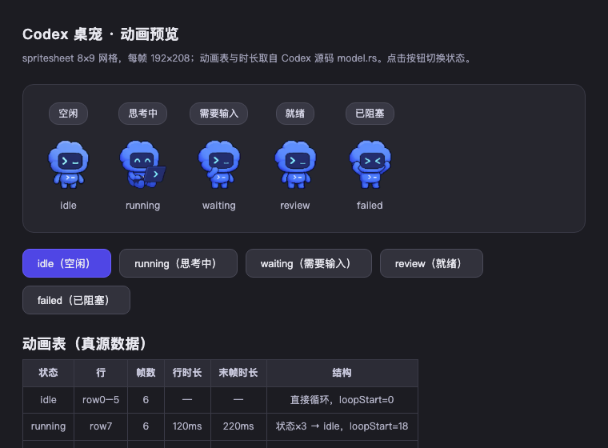

# codex-pet

🐾 把 [OpenAI Codex CLI](https://github.com/openai/codex) 的终端桌宠（ambient pet）移植到 [DSH（DeepSeek Harness）](https://github.com/ranxianglei/billion-context)桌面端的社区插件。

在 DSH 界面右下角输入框上方悬浮一只会动的小宠物，实时反映当前 AI 会话状态——跑任务时蹦跶、等你输入时招手、干完了乖乖待机。



> 截图待补：插件加载后宠物悬浮于 composer 上方的效果。

## 特性

- **状态机与 Codex 原版逐帧一致** —— 动画行号、帧数、逐帧时长全部取自 codex-rs `tui/src/pets/model.rs` 真源，无任何猜测：
  | DSH 会话状态                   | 宠物状态    | 动画      | 帧数 | 时长                          |
  | -------------------------- | ------- | ------- | -- | --------------------------- |
  | 会话运行中                      | running | row 7   | 6  | 120ms ×5 + 220ms            |
  | 等待用户输入（pendingInteraction） | waiting | row 6   | 6  | 150ms ×5 + 260ms            |
  | 完成未读（completionUnread）     | review  | row 8   | 6  | 150ms ×5 + 280ms            |
  | 其他 / 空闲                    | idle    | row 0–5 | 6  | 1680/660/660/840/840/1920ms |
  每种状态动画播放 3 遍后回落 idle 循环，与 Codex `app_state_animation()` 行为完全一致。
- **渲染一致** —— 直接引用 OpenAI 官方 spritesheet（8×9 网格，每帧 192×208），CSS `background-position` 切帧 + `requestAnimationFrame` 推进，宠物高度 75px 与原版 `PET_TARGET_HEIGHT_PX` 对齐。
- **零构建、零依赖** —— 纯 JS 单文件 client bundle，`window.__ModuleLoader__` 注入即用。
- **中英双语气泡** —— 状态气泡随界面语言切换（思考中 / Thinking 等）。
- **不打包任何 OpenAI 资产** —— spritesheet 运行时从官方 CDN 加载，仓库内无图像资源。

## 安装

### 方式一：本地目录 + pnpm link（推荐）

1. 克隆本仓库到任意位置：
   ```bash
   git clone https://github.com/62652098hg/dsh-codex-pet.git
   cd dsh-codex-pet
   ```
2. 在 DSH profile 里注册依赖与 bundle（编辑 `~/.dsh/profiles/desktop/package.json`）：
   ```json
   {
     "dependencies": {
       "@local/codex-pet": "link:/path/to/codex-pet"
     },
     "dsh": {
       "profile": {
         "bundles": [
           "@local/codex-pet"
         ]
       }
     }
   }
   ```
3. 安装并重启 DSH：
   ```bash
   cd ~/.dsh/profiles/desktop && pnpm install
   ```
   重启 DSH，宠物出现在输入框上方。

### 方式二：单文件手动注入

`client.js` 是自包含的 client bundle，任何支持 `window.__ModuleLoader__.load({id, factory})` 注入的 DSH 环境均可直接加载。

## 工作原理

```
DSH 启动
  └─ 扫描 profile bundles → 发现 @local/codex-pet 声明 dsh.client
      └─ 将 client.js 组合进 client combo 注入 web 页面
          └─ window.__ModuleLoader__.load({ id, factory })
              └─ 注册 shell.overlay slot
                  └─ CodexPet 组件
                      ├─ useSessions        → 取 retainedBy.mainView>0 的主会话
                      ├─ useSessionStatus   → 读 running / pendingInteraction / completionUnread 快照
                      ├─ resolveState()     → 映射为 idle/running/waiting/review
                      └─ rAF 切帧渲染       → CSS background-position 对齐 8×9 spritesheet
```

状态优先级：`pendingInteraction（waiting）> running > completionUnread（review）> idle`，与 Codex 原版语义一致。Codex 的 `failed` 状态在 DSH 侧无对应数据源，未做映射（不瞎编）。

## 文件结构

```
codex-pet/
├── client.js          # client bundle：状态机 + 动画表 + 渲染（核心）
├── index.js           # host 半区入口（渲染全在 client 半区）
├── cordis.patch.yml   # bundle patch：向 loader 注册插件
├── icon.svg           # 插件图标
├── preview.html       # 浏览器动画预览页（双击即看，无需 DSH）
├── LICENSE            # MIT
└── .gitignore
```

## 预览

不装 DSH 也能看动画效果：用浏览器直接打开 `preview.html`，五个状态同屏播放，动画数据与插件本体完全一致。

## 致谢与声明

- 宠物形象、spritesheet 与动画设计版权归 **OpenAI** 所有，本项目仅运行时引用其官方 CDN 资源。
- 本项目为**社区复刻，非官方**，与 OpenAI 无任何关联。
- 状态机与动画参数逆向自开源项目 [openai/codex](https://github.com/openai/codex)（`codex-rs/tui/src/pets/`）。

## License

[MIT](LICENSE)
